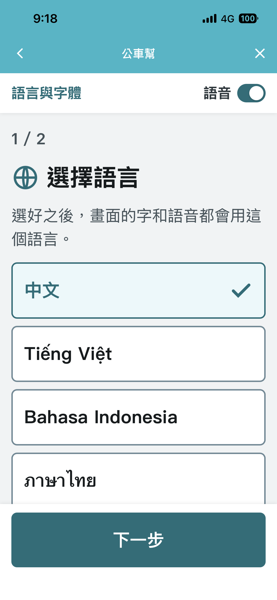
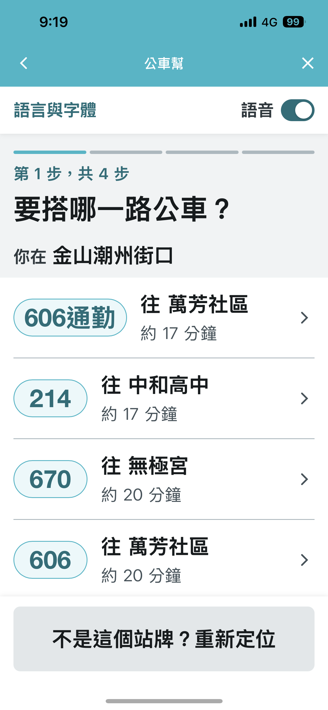
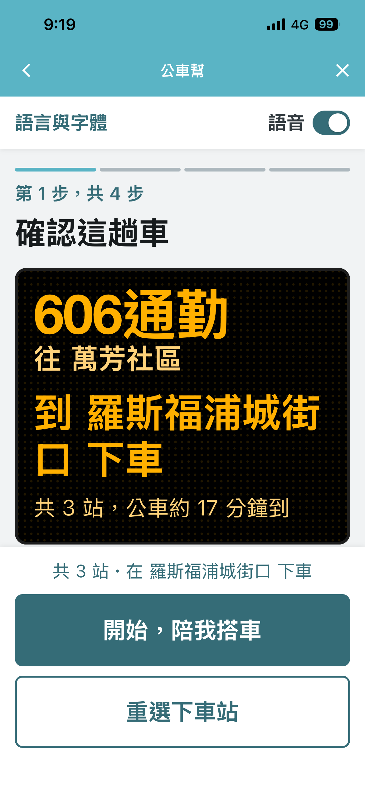
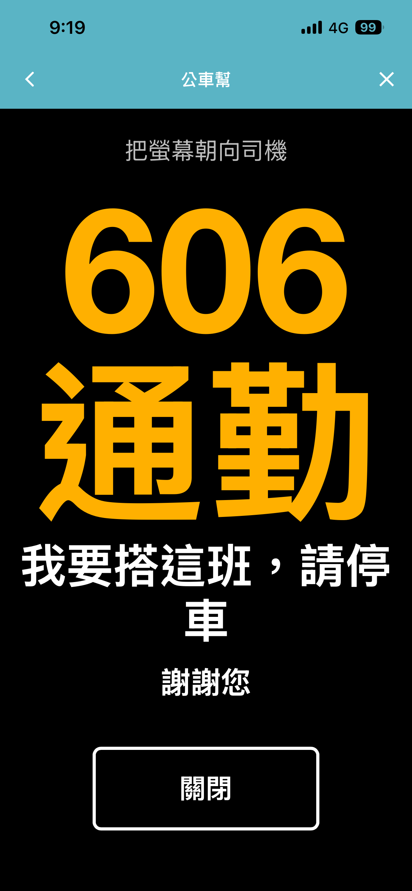
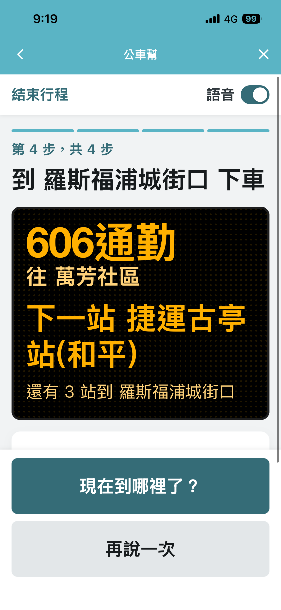
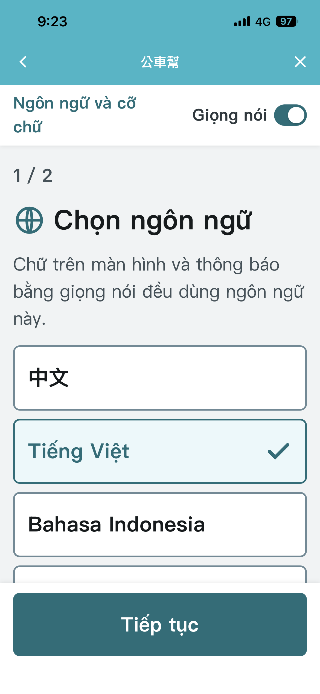
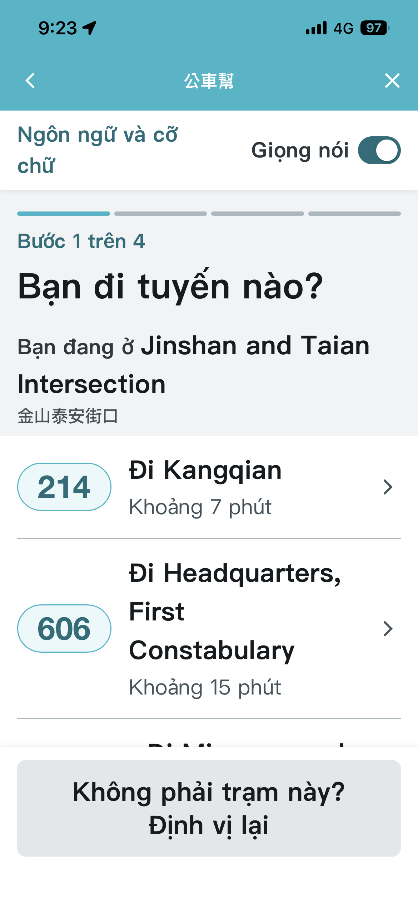
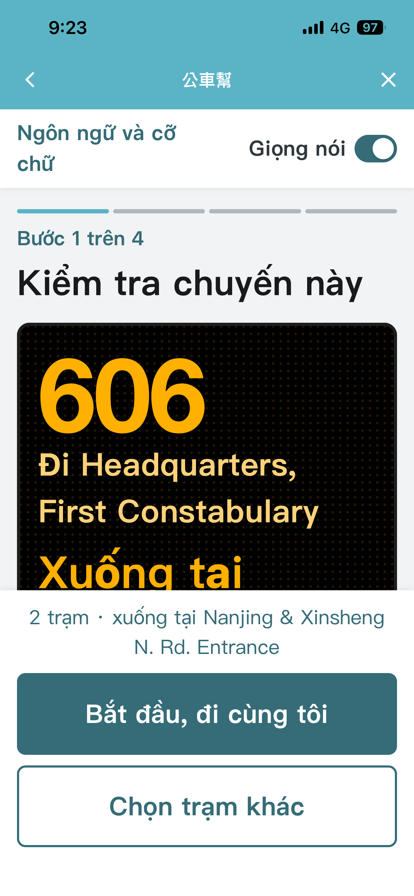
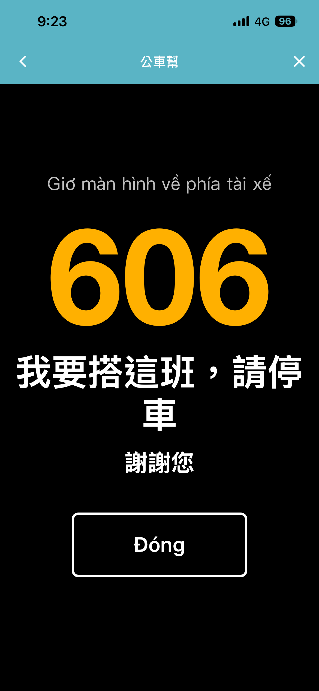
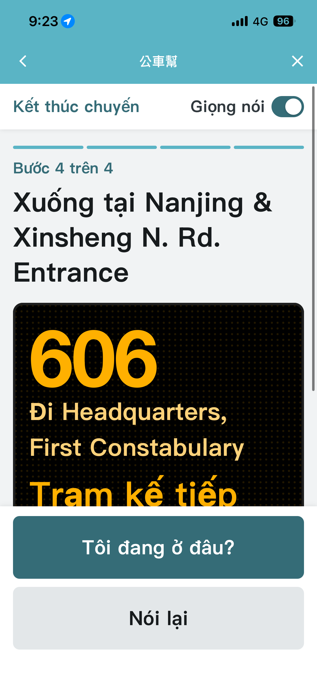

# Bussistant 公車幫

> 2026 臺北秋季程式設計節・城市通微服務大黑客松 — 隊伍「邱記黑可頌」

**子題**：用不了（數位輔助設計，降低「操作」門檻）

**一句話**：在手機上陪你把一趟公車搭完 —— 什麼時候該攔車、有沒有上對車、什麼時候該按鈴下車，都用大字、語音和震動主動告訴你。

## 畫面

實機截圖（iPhone，城市通 App 內執行）。同一套流程，語言和字體大小可以分開選。

| | ① 選語言與字體 | ② 選路線 | ③ 確認這趟車 | ④ 舉牌攔車 | ⑤ 下車提醒 |
|---|---|---|---|---|---|
| **中文** |  |  |  |  |  |
| **Tiếng Việt** |  |  |  |  |  |

## 使用情境

搭公車其實有四個各自獨立的難關，而現有的 App 只解決了第一個（查到站時間）：

| 難關 | 現況 | 公車幫怎麼做 |
|---|---|---|
| 車什麼時候來 | 要一直盯著螢幕或站牌 | 車快到時主動語音＋震動提醒，手機可以收起來 |
| 怎麼讓車停下來 | 台北的公車要招手才停 | 車進站的那一刻才跳出「舉牌攔車」大字卡，螢幕朝向司機 |
| 有沒有上對車 | 上車後只能問司機或憑感覺 | 比對手機位置與該路線公車的即時位置，確認搭對 |
| 什麼時候下車 | 要一路數站、看跑馬燈 | 剩兩站預告、剩一站最強震動提示按鈴 |

**主要使用者**：長者、不熟悉智慧型手機的人、看不懂中文的新住民。三種人卡在不同的地方，
所以服務把「語言」和「字體大小」拆成兩個獨立選項 —— 新住民需要的是語言，長者需要的是大字，
而一位看不清楚的越南籍長輩兩者都需要，不該被迫二選一。

**情境舉例**：七十多歲、看得到但看不清楚站牌的長輩，要從住處搭公車去醫院。打開城市通 →
公車幫 → 選中文、大字 → 服務用大字顯示附近站牌與可搭路線 → 選好路線和下車站之後把手機收進口袋 →
車快到時手機震動並說「307 即將進站，請準備上車」→ 舉起螢幕讓司機看到「我要搭這班，請停車」→
上車後服務確認「你在 307 上」→ 快到站時震動提醒「下一站就是臺大醫院，請按下車鈴」。

全程不需要看懂站牌、不需要問人、不需要一路盯著螢幕。

## 架構
```
城市通 App (app/, Flutter) ⇄ flutterObject ⇄ 微服務網頁 (frontend/) ─► 後端 (backend/, 選配) ─► 開放資料
```

## 執行方式
### App
```bash
cd app
flutter pub get
dart run build_runner build --delete-conflicting-outputs
flutter run
```
需求：Flutter 3.47.6、Xcode（iOS）或 Android Studio + Java 17（Android）。

### 微服務網頁
```bash
cd frontend
npm install
npm run dev     # 未設定 VITE_API_BASE 時使用模擬資料
npm run build
```
Vue 3 + Vite + TypeScript。流程、Demo 參數、**在城市通 WebView 裡執行的方法**、後端 API 約定與 App 端 Handler 見 [`frontend/README.md`](frontend/README.md)。

### 後端
```bash
cd backend
cp .env.example .env          # 填入 TDX_CLIENT_ID / TDX_CLIENT_SECRET
python3 -m venv .venv && .venv/bin/pip install -r requirements.txt
.venv/bin/uvicorn app.main:app --reload --port 8080
```
Python 3.12 + FastAPI，代理 TDX 公車 API（金鑰只留在後端）。
Docker image 已驗證可建置並以真實 TDX 資料運行（162 MB，讀 `PORT` 環境變數）。
端點、用到的 TDX 欄位、快取策略與已知限制見 [`backend/README.md`](backend/README.md)；
環境變數見 `backend/.env.example`。

### 一次部署前後端

```bash
# 前置（你本人在終端機跑一次就好）
gcloud auth login
gcloud config set project <你的 GCP 專案>
firebase login

./scripts/deploy.sh
```

腳本的順序是刻意的：後端先上 → 拿到它的 HTTPS 網址 → 才 build 前端
（`VITE_API_BASE` 是 Vite 的**編譯期**變數，順序顛倒前端會指向 localhost）→
最後把前端網址填進 `app/lib/util/bus_assist_config.dart` 的 `defaultValue`，重新 `flutter run`。

Cloud Run 需要「已啟用計費」的 GCP 專案（免費額度對這個服務很夠）。確認方式：
`gcloud billing projects describe <專案 id>`。

腳本用 `--set-env-vars` 帶 TDX 金鑰，方便但會留在 Cloud Run 的服務設定裡。
長期維運建議改用 Secret Manager（`--set-secrets`）。

### CI/CD（GitHub Actions）

| Workflow | 觸發 | 做什麼 |
|---|---|---|
| `.github/workflows/ci.yml` | 每次 push 與 PR | 前端 `vue-tsc` + build、後端 `compileall` + import 檢查、`docker build` |
| `.github/workflows/deploy.yml` | push 到 `main`（限 `backend/`、`frontend/` 變動）或手動 | 部署 Cloud Run → 煙霧測試 `/health` → 用後端網址 build 前端 → 部署 Firebase Hosting |

CI 不需要任何 secret。部署用 **Workload Identity Federation**，沒有長期金鑰檔案 ——
repo 依比賽規定必須公開，service account key 一旦外流等於整個 GCP 專案外流。

一次性設定（會修改 GCP IAM，請本人執行）：

```bash
./scripts/setup-cicd.sh
```

它會建立 `github-deployer` service account、授權、建立 workload identity pool 與
provider（用 `attribute-condition` 鎖死只有本 repo 能用），並寫入三個 GitHub
repo variable：`GCP_PROJECT_ID`、`GCP_WIF_PROVIDER`、`GCP_DEPLOY_SA`。

**TDX 金鑰不在 GitHub。** 它掛在 Cloud Run 的服務設定上，`deploy.yml` 刻意不帶
`--set-env-vars`，重新部署會原封不動保留現有環境變數。這樣金鑰只存在一個地方。

## 資料來源
所有欄位都對照 TDX 線上 OpenAPI spec（`公共運輸-公車`，2026/11/07 查證）確認過，
spec 與欄位代碼對照表見 [`backend/README.md`](backend/README.md)。

| 資料集 | 來源平台 | 連結 | 核心／模擬 |
|---|---|---|---|
| 市區公車站位資料（臺北市） | TDX | https://tdx.transportdata.tw/api/basic/v2/Bus/Station/City/Taipei | 核心 |
| 市區公車路線資料（臺北市） | TDX | https://tdx.transportdata.tw/api/basic/v2/Bus/Route/City/Taipei | 核心 |
| 市區公車路線站序資料（臺北市） | TDX | https://tdx.transportdata.tw/api/basic/v2/Bus/StopOfRoute/City/Taipei | 核心 |
| 市區公車預估到站資料 N1（臺北市） | TDX | https://tdx.transportdata.tw/api/basic/v2/Bus/EstimatedTimeOfArrival/City/Taipei | 核心 |
| 市區公車動態定點資料 A2（臺北市） | TDX | https://tdx.transportdata.tw/api/basic/v2/Bus/RealTimeNearStop/City/Taipei | 核心 |
| 市區公車動態站牌資料 A1（臺北市） | TDX | https://tdx.transportdata.tw/api/basic/v2/Bus/RealTimeByFrequency/City/Taipei | 核心 |
| 市區公車車輛資料（臺北市，判斷低地板） | TDX | https://tdx.transportdata.tw/api/basic/v2/Bus/Vehicle/City/Taipei | 核心 |
| 前端模擬路線與到站資料（`frontend/src/data/mock.ts`，非真實路線） | — | — | 模擬 |

未設定 `VITE_API_BASE` 時前端跑的是上表最後一列的**模擬資料**，畫面左上角會顯示「模擬資料」。

## 第三方套件
| 套件 | 用在哪 | 授權 |
|---|---|---|
| TownPass | app | GPL-3.0 |
| flutter_tts | app（語音播報） | MIT |
| vue | frontend | MIT |
| vue-router | frontend | MIT |
| vite、@vitejs/plugin-vue（開發用） | frontend | MIT |
| typescript（開發用） | frontend | Apache-2.0 |
| vue-tsc、@vue/tsconfig（開發用） | frontend | MIT |
| fastapi | backend | MIT |
| uvicorn | backend | BSD-3-Clause |
| httpx | backend | BSD-3-Clause |
| python-dotenv | backend | BSD-3-Clause |
| pydantic（fastapi 相依） | backend | MIT |

## AI 使用聲明
- 開發階段：使用 Claude Code 協助開發。
- **執行階段：本作品沒有任何 AI／LLM 推論**，不論在裝置端或雲端皆無。
  所有判斷（最近站牌、到站時間、是否搭對車、剩幾站）都是開放資料加上明確的幾何與狀態運算，
  沒有模型檔、沒有推論框架，因此評審關閉網路時的行為與平常一致（會改用快取資料，見下方「已知限制」）。
- 語音播報（TTS）使用手機作業系統內建的語音引擎（iOS／Android 系統語音），在裝置端完成，
  不送雲端、不呼叫任何遠端模型。本服務沒有語音辨識（STT）功能。

## 授權
本作品以 [AGPL-3.0](LICENSE) 授權。`app/` 衍生自 [taipei-doit/TownPass](https://github.com/taipei-doit/TownPass)（GPL-3.0）。

## 團隊
邱記黑可頌：吳盛瑋、周佑康、劉竑毅、連語馨、鄭知庭
